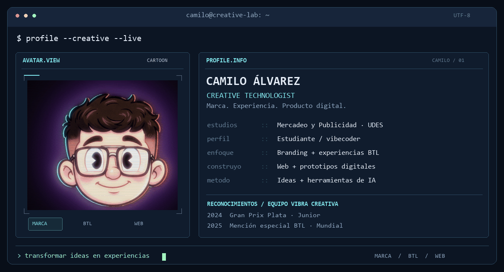
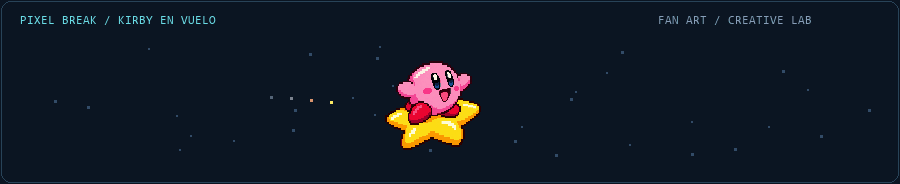

  <picture>
    <source media="(max-width: 600px)" srcset="assets/terminal-mobile-cartoon.png" />
    
  </picture>

  <a href="https://www.linkedin.com/in/alvarez-morera-camilo-andres-ba32403b1/">LinkedIn</a> &nbsp; / &nbsp;
  <a href="#user-content-proyectos-para-explorar">Explorar proyectos</a> &nbsp; / &nbsp;
  <a href="#user-content-reconocimientos">Reconocimientos</a> &nbsp; / &nbsp;
  <a href="assets/terminal-poster-cartoon.png">Ficha sin movimiento</a>

<h1 align="center">Camilo Álvarez</h1>

<strong>Creative Technologist · Mercadeo & Publicidad · UDES</strong> 
Del concepto de marca a la experiencia interactiva.

Soy **Camilo Andrés Álvarez Morera**. Conecto mi formación en mercadeo y publicidad con identidad visual, experiencias interactivas y prototipos digitales.

Me identifico como **vibecoder**: uso IA para explorar y construir mientras aprendo. Me interesa el recorrido entre un concepto creativo y algo que una persona pueda ver, recorrer o probar.

**Mi punto de encuentro:** branding, comunicación visual, experiencias BTL y tecnología creativa.

## Proyectos para explorar

| Proyecto | Concepto / formato | Explorar |
| :--- | :--- | :--- |
| **01 · Flor Export Challenge** | Aprender jugando. Cuatro decisiones y un recorrido interactivo sobre exportación de flores. | [Jugar ↗](https://camilo1120.github.io/flor-export-challenge/) · [Código](https://github.com/camilo1120/flor-export-challenge) |
| **02 · IKAR** | Presencia de marca. Sitio corporativo de IKAR Soluciones en Construcción. | [Proyecto ↗](https://github.com/camilo1120/IKAR) |
| **03 · Rosa Origen** | Prototipo móvil. Consulta de lotes, QR de muestra e inspección visual de rosas. | [Demo ↗](https://camilo1120.github.io/rosa-origen-pwa/) · [Repositorio](https://github.com/camilo1120/rosa-origen-pwa) |

Antes de explorar / alcance de las demos

**Flor Export Challenge:** experiencia didáctica; no sustituye orientación técnica o normativa de exportación. Créditos de imágenes en su repositorio.

**IKAR:** código y documentación disponibles. Aún no se ha confirmado una URL pública de demo.

**Rosa Origen:** evaluación visual orientativa y heurística; no es un modelo de calidad validado ni un sistema de control comercial. El repositorio contiene la compilación estática del frontend. Fuente completa y backend están fuera de ese repositorio; cámara y NFC dependen de permisos y compatibilidad.

<strong>En el laboratorio / AMPER-PACKMAN-LATA</strong>

Experimento web disponible para explorar. Su ficha de concepto, proceso y participación está en preparación.

[Abrir demo](https://camilo1120.github.io/AMPER-PACKMAN-LATA/) · [Ver repositorio](https://github.com/camilo1120/AMPER-PACKMAN-LATA)

<strong>Estudio visual / Lechonas Chevo</strong>

Una muestra de identidad visual de mi selección de trabajos: logotipo, paleta, tipografía y aplicaciones de marca. Las aplicaciones se presentan como mockups; no se atribuyen resultados comerciales a esta pieza.

## Reconocimientos

Como integrante de **Vibra Creativa**:

- **2024 — Gran Prix Plata, categoría Junior.** Premios Élite. [Resultado del equipo · UDES](https://udes.edu.co/premios-elite/noticias/exito-total-en-la-23-edicion-de-los-premios-elite-de-la-udes-reconocimiento-a-la-excelencia-creativa-con-alkosto-y-ktronix).
- **2025 — Mención especial BTL, categoría Mundial.** Premios Élite. [Cobertura del reconocimiento](https://www.vanguardia.com/informes-comerciales/2025/10/22/alkosto-y-ktronix-apoyan-el-talento-creativo-de-los-jovenes-en-los-premios-elite-2025/).

## Lo que estoy explorando

**Marca:** concepto, identidad y narrativa visual.  
**Experiencia:** interacción, juego y propuestas BTL.  
**Producto:** prototipos web y procesos creativos asistidos por IA.

En los repositorios puedes encontrar HTML, CSS y JavaScript. Cada proyecto tiene su propio alcance; una demo muestra una exploración, no implica resultados comerciales.

---

**¿Trabajas donde se encuentran las marcas y la tecnología?** [Conversemos en LinkedIn ↗](https://www.linkedin.com/in/alvarez-morera-camilo-andres-ba32403b1/).

Rincón pixel: fan art decorativo de Kirby, sin afiliación con Nintendo ni HAL Laboratory. El retrato cartoon fue proporcionado por Camilo.

