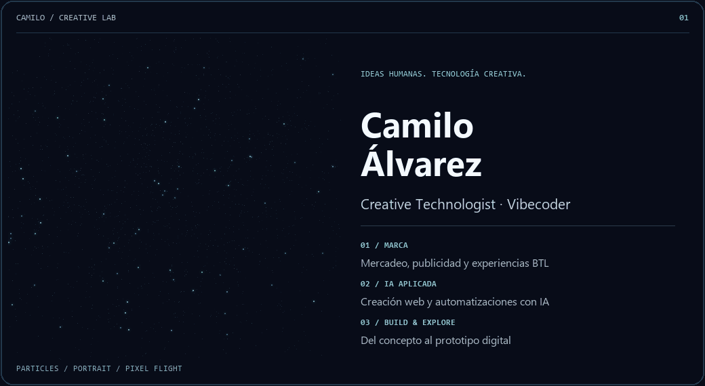

<h1 align="center">Camilo Álvarez</h1>

<strong>Mercadeo y Publicidad en UDES · IA generativa aplicada a marketing</strong> 
Marca, BTL y prototipado digital.

  <picture>
    <source media="(max-width: 600px)" srcset="assets/camilo-story-v4-mobile.gif" />
    
  </picture>

  <a href="https://www.linkedin.com/in/camilo-andr%C3%A9s-%C3%A1lvarez-morera-ba32403b1/">LinkedIn</a> &nbsp; / &nbsp;
  <a href="#user-content-proyectos-para-explorar">Explorar proyectos</a> &nbsp; / &nbsp;
  <a href="#user-content-reconocimientos">Reconocimientos</a> &nbsp; / &nbsp;
  <a href="assets/camilo-story-v4-desktop-poster.png">Ficha sin movimiento</a>

Soy **Camilo Andrés Álvarez Morera**, estudiante de Mercadeo y Publicidad y Creative Technologist. Uso IA generativa para explorar conceptos y acelerar prototipos web. Me identifico con el *vibe coding*: parto de una idea, construyo con asistencia de IA e itero sobre lo que puedo mostrar o probar.

## Lenguajes y tecnologías

Uso lenguajes y tecnologías con asistencia de IA y vibecoding, según las necesidades de cada proyecto.

  
  
  
  
  
  
  
  
  
  
  
  
  
  
  
  
  
  
  

JavaScript · TypeScript · Python · HTML · CSS · Java · C · C++ · C# · Go · Rust · PHP · Ruby · Kotlin · Swift · Dart · SQL · Bash · PowerShell

## Herramientas de IA que uso

  
  
  
  
  

**Hermes Agent · Google Antigravity · OpenAI Codex · DeepSeek · Claude Code**

Iconos: [Devicon](https://github.com/devicons/devicon) y [Lobe Icons](https://github.com/lobehub/lobe-icons). [Fuentes y licencias](assets/tool-icons/sources.json).

## Proyectos para explorar

- **Flor Export Challenge** · Juego didáctico con cuatro decisiones sobre exportación de flores. [Jugar](https://camilo1120.github.io/flor-export-challenge/) · [Ver código](https://github.com/camilo1120/flor-export-challenge)
- **IKAR** · Sitio corporativo para una constructora. [Ver código y documentación](https://github.com/camilo1120/IKAR)
- **Rosa Origen** · Prototipo móvil de consulta de lotes e inspección visual orientativa mediante heurísticas. [Abrir demo](https://camilo1120.github.io/rosa-origen-pwa/) · [Ver compilación estática](https://github.com/camilo1120/rosa-origen-pwa)

Antes de explorar / alcance de las demos

**Flor Export Challenge:** experiencia didáctica; no sustituye orientación técnica o normativa de exportación. Créditos de imágenes en su repositorio.

**IKAR:** código y documentación disponibles. Aún no se ha confirmado una URL pública de demo.

**Rosa Origen:** evaluación visual orientativa y heurística; no es un modelo de calidad validado ni un sistema de control comercial. El repositorio contiene la compilación estática del frontend. Fuente completa y backend están fuera de ese repositorio; cámara y NFC dependen de permisos y compatibilidad.

## Laboratorio de IA y marketing

- **Automatizaciones y CRM.** Me interesa prototipar el flujo de captura, clasificación y seguimiento de contactos, con revisión humana antes de enviar comunicaciones.
- **Producto SaaS.** Exploro cómo convertir una tarea repetitiva de marketing en una herramienta web que se pueda probar con datos de ejemplo.
- **Novedades que sigo.** Skills y automatizaciones de agentes para flujos repetibles, y llamadas a funciones para conectar modelos con herramientas. [Actualizaciones de ChatGPT y Codex](https://learn.chatgpt.com/docs/changelog) · [Documentación de Gemini sobre llamadas a funciones](https://docs.cloud.google.com/gemini-enterprise-agent-platform/models/tools/function-calling)

<strong>En el laboratorio / AMPER-PACKMAN-LATA</strong>

Experimento web disponible para explorar. Su ficha de concepto, proceso y participación está en preparación.

[Abrir demo](https://camilo1120.github.io/AMPER-PACKMAN-LATA/) · [Ver repositorio](https://github.com/camilo1120/AMPER-PACKMAN-LATA)

<strong>Estudio visual / Lechonas Chevo</strong>

Una muestra de identidad visual de mi selección de trabajos: logotipo, paleta, tipografía y aplicaciones de marca. Las aplicaciones se presentan como mockups; no se atribuyen resultados comerciales a esta pieza.

## Reconocimientos

Como integrante de **Vibra Creativa**:

- **2024 — Gran Prix Plata, categoría Junior.** Premios Élite. [Resultado del equipo · UDES](https://udes.edu.co/premios-elite/noticias/exito-total-en-la-23-edicion-de-los-premios-elite-de-la-udes-reconocimiento-a-la-excelencia-creativa-con-alkosto-y-ktronix).
- **2025 — Mención especial BTL, categoría Mundial.** Premios Élite. [Cobertura del reconocimiento](https://www.vanguardia.com/informes-comerciales/2025/10/22/alkosto-y-ktronix-apoyan-el-talento-creativo-de-los-jovenes-en-los-premios-elite-2025/).

## Lo que estoy explorando

**Marca:** concepto, identidad y narrativa visual.  
**Experiencia:** interacción, juego y propuestas BTL.  
**Producto:** prototipos web y procesos creativos asistidos por IA.

---

**¿Trabajas donde se encuentran las marcas y la tecnología?** [Conversemos en LinkedIn ↗](https://www.linkedin.com/in/camilo-andr%C3%A9s-%C3%A1lvarez-morera-ba32403b1/).

Retrato animado construido con caracteres a partir de mi fotografía; profundidad aproximada y partículas. Inspiración visual: <a href="https://github.com/lowlighter/metrics">GitHub Metrics</a>.

Kirby: fan art; personaje de Nintendo / HAL Laboratory. Animación de partículas generada en Python.

Sprites de Kirby: Pieninja314; adaptación de sophiebaybey. [Fuente: Spelunky FYI](https://spelunky.fyi/mods/m/pieninja314s-kirby-updated/). Personaje de Nintendo / HAL Laboratory.
